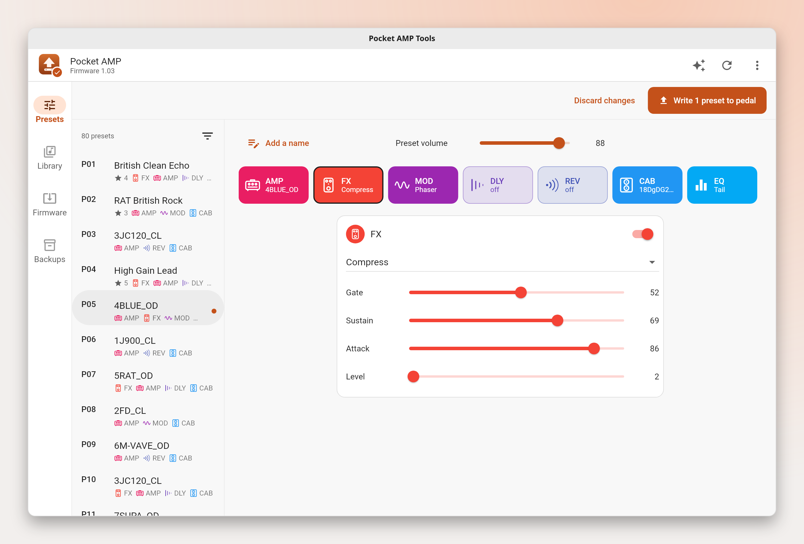

# Pocket AMP Tools

[](https://github.com/vitoramaral10/pocket-amp-tools/actions/workflows/build.yml)
[](https://github.com/vitoramaral10/pocket-amp-tools/releases)
[](https://github.com/vitoramaral10/pocket-amp-tools/releases)
[](LICENSE)


A free, open-source app to **edit the presets, manage the IRs and amp captures, back up and update the firmware** of the **Pocket AMP** guitar pedal, on **Windows, macOS, Linux and Android**.

It works with the pedal whatever brand is printed on it: **M-VAVE Pocket AMP**, **Donner Pocket AMP**, **Coolmusic PIXIE1**, **New Bee SK17** and others. Website: <https://vitoramaral10.github.io/pocket-amp-tools/>

<picture>
  <source srcset="docs/screenshot-dark.png" media="(prefers-color-scheme: dark)">
  
</picture>

## What it does

- **Preset editor, heard live.** All 80 presets on one screen: signal chain, models, knobs and EQ. Each change plays on the pedal as you make it, and nothing is stored until you write. [More](#presets)
- **Names, tags and ratings** for your presets, with a filter, and keyboard shortcuts for everything.
- **Optional AI assistant**, on a service and key of your choice: ask for a sound and it edits the preset for you.
- **Library for IRs and amp captures.** Send your own IRs and [TONE3000](https://www.tone3000.com) A2 `.nam` captures to the pedal's 20 CAB and 20 AMP slots, and see which file is in which slot. [More](#presets)
- **Bluetooth** editing on Linux and Android. [More](#bluetooth-linux-and-android)
- **Backups you can read.** Every preset is saved as plain JSON that you can edit by hand and restore. One is taken automatically before each firmware update.
- **Firmware update.** Fetches the current firmware from M-VAVE (V1.05) and installs it over plain USB-MIDI, with no drivers. [More](#how-to-update)

## Why use it instead of M-VAVE's software

- **Your sounds are yours.** Presets live in open, documented files on your computer, not only inside the pedal.
- **You can tell your presets apart.** Give each preset a name, a description, genres, tags and a 1 to 5 star rating, then filter the list by them. In M-VAVE's software a preset is only a number, P01 to P80.
- **It runs where the official software does not.** M-VAVE's firmware updater runs only on Windows; this app runs on macOS, Linux and Android too ([what was tested on each](#status)). On Android it also runs on 32-bit devices that M-VAVE's app does not install on.
- **It installs the current firmware.** At the time of writing, M-VAVE's "POCKET AMP" updater bundle ships an older firmware than the one on its own downloads page. This app downloads the current official file.
- **Updating is safer for your presets.** A firmware update can overwrite presets and their EQ. The app backs them all up first and restores the ones that changed afterwards, and it can resume an update that stopped halfway.
- **It refuses to do harm.** The firmware package, the pedal's identity and every packet sent are checked before anything is written. [See the safety checks](#safety-checks)
- **It is open source** (GPL-3.0): you can read what it sends to your pedal, and fix or extend it.

> **Community tool, not affiliated with M-VAVE or any other brand of the pedal. Use at your own risk.** A firmware update that is interrupted can leave the pedal unusable. The firmware itself comes from M-VAVE; this app only delivers it.

What each release changed is in the [changelog](CHANGELOG.md). The app was formerly called **Pocket AMP Upgrader**: it grew from a firmware updater into a preset editor, and was renamed.

## Download

Get the build for your system from the newest entry on the [releases page](../../releases):

| System | File | How to run |
| --- | --- | --- |
| Windows 10/11 (x64) | `pocket-amp-tools-windows-x64.zip` | Unzip, run `pocket-amp-tools.exe`. If SmartScreen warns, choose *More info → Run anyway*. |
| macOS 11+ | `pocket-amp-tools-macos.zip` | Unzip, then right-click *Pocket AMP Tools* → *Open* (the app is not signed). |
| Linux (x64) | `Pocket_AMP_Tools-x86_64.AppImage` | `chmod +x` it and run it. Or use `pocket-amp-tools-linux-x64.tar.gz`. Needs GTK 3 and ALSA (`libasound2`). |
| Android 8+ | `pocket-amp-tools-android.apk` | Open it on the phone and allow your browser or file manager to install apps. It is also on its way to [F-Droid](https://f-droid.org), which builds and signs it with its own key: Android will not update one copy over the other, and uninstalling to switch deletes the backups kept in the app, so save them elsewhere first. |

Each release lists the SHA-256 of every file in `SHA256SUMS.txt`. Releases from v0.3.0 on also let you check that a file was built by this repository's CI: `gh attestation verify <file> --repo vitoramaral10/pocket-amp-tools`.

## How to update

1. Know that a firmware update can overwrite some presets and their EQ. The app backs up all 80 presets and their EQ automatically before updating, and you can also save a backup to a file at any time.
2. Charge the pedal, connect it with a USB **data** cable and turn it on.
3. Close the M-VAVE app and anything else that uses MIDI (DAWs, browser tabs with Web MIDI).
4. Open Pocket AMP Tools. It detects the pedal and shows the installed version.
5. Open the **Firmware** section. With the pedal on USB, the app fetches the official file from M-VAVE's server on its own (once per run) and says whether your pedal is already up to date; if it is, there is nothing else to do. To use a file you already have, click **Open .fwsc file…**.
6. Click **Update firmware**, confirm, and wait about two minutes. The pedal restarts twice: once into update mode, once into the new firmware.
7. Click **Restore my presets from before the update**. Only the presets and EQ that changed are written back, and the result is read back to check it.

To check the installed version on the pedal itself, hold **Home** and press **>**.

### The Pocket AMP under other brands

The same pedal is sold under other brands, and each reports its own name. The app keeps a list of names confirmed to be a Pocket AMP. A listed pedal is detected as *NAME (Pocket AMP)* and can get the Pocket AMP firmware after a separate confirmation. A pedal that is not on the list never gets a firmware update, because a different pedal that speaks the same protocol (an M-VAVE FM-1, for example) would be bricked by it. If its preset area reads like a Pocket AMP's, it is detected as *presets only*: backups, presets and raw copies work, updates do not.

| Sold as | Reports | Status |
| --- | --- | --- |
| Coolmusic PIXIE1 | `PIXIE1_007` | updated to V1.05 by an owner ([#2](../../issues/2)) |
| New Bee SK17 | `SK17_006` | updated to V1.05 by an owner |
| Donner Pocket AMP | `DONNER Pocket AMP_008` | updated from V08 to V1.05 by an owner on Windows, presets kept ([discussion #1](../../discussions/1)) |

Is yours sold under a name that is not listed? Open the app, copy the log (**⋮ → Settings → Copy for a bug report**), and send it with the [hardware test report](../../issues/new?template=hardware_report.yml) form.

Know before you put the Pocket AMP firmware on a pedal of another brand:

- afterwards the pedal reports itself as a Pocket AMP, and there may be no firmware of the original brand to go back to;
- older firmware of another brand (PIXIE1 V0.07) keeps presets in the same layout but has no EQ table and cannot read past P79. The app keeps a raw copy (`raw-<pedal>-<date>.bin` in `Documents/Pocket AMP Tools`) and asks before continuing; after the update, **P01 to P79 can be restored** from it (the result card or **Backups**). P80 and the EQ stay as the new firmware has them. A raw copy in any other layout is not restored. Reading presets on that firmware shows P01 to P79 without the EQ, to view only: writing to it was never tested;
- after updating from V0.07, M-VAVE says to switch to Speaker mode and load the Speaker mode preset in M-EFCS to get sound.

### "Already runs this version"

The Pocket AMP does not reinstall the firmware it already has: it reads the package and stops. The app checks the version first and tells you instead of starting.

### If it stops halfway

Do not unplug the pedal in a hurry. If the app says the pedal did not come back, reconnect it, open the app again and click **Detect pedal**. A pedal waiting in update mode shows up as *update mode*, and **Resume update** writes the firmware again from there.

## Presets

The **Presets** section reads all 80 presets and their EQ from the pedal as soon as it is detected, and lets you edit them: volume, the order of the signal chain, each block's on/off, model and knobs, and the EQ. AMP and CAB model names are read from the pedal, so models you uploaded show with their own names.

The chain keeps FX and AMP in its first two places (in either order); the other four blocks go in any order. A V1.05 pedal acknowledges and ignores any other order, so the editor does not offer it.

Edits are heard live: selecting a preset plays it on the pedal, and each change to a block, model, knob or the chain is heard as you make it. Live changes are not stored: switching presets on the pedal or turning it off brings back what is saved. Volume and EQ have no live command and are heard after writing. Changing a model resets that block's knobs to the new model's defaults, as on the pedal itself.

**Write to pedal** stores only the presets that changed, then reads them back to confirm. If the pedal changed since its presets were read (a preset saved on the pedal, or another unit plugged in), nothing is written and the app asks for a new read. Every write is read back before it is stored, and is stored even when nothing differed, so a write whose storing step was lost is completed by the next one. Reading again, opening a file or closing the app with edits not on the pedal asks first. A preset can be copied as JSON, with its name, description, labels and rating, and pasted back.

Each preset can also have a **name, description, genres, usage, tags and a 1 to 5 star rating**, set with the pencil button above the preset. The pedal has no room for these, so the app keeps them on your computer (`preset-details.json` in the app's data folder), one set per slot P01 to P80, whatever is stored in it; they are saved as you type. Saved files and backups carry them too, and opening one whose details differ asks whether to use them, so they move with the presets to another computer or phone. The genres, usage and tags to pick from are yours to add and remove. The filter button above the list (beside the preset picker on a narrow window) shows only the presets that match: any of the values picked in a group, every group at once, and at least the chosen rating. The assistant sees these details too, and sets them when asked.

On the keyboard, **←**/**↑** and **→**/**↓** select the previous and next preset the filter shows (played on the pedal as a click would), **Page Up**/**Page Down** move 10 presets and **Home**/**End** go to the first and last; **F2** asks for a preset number and jumps to it whatever the filter shows. **1** to **7** open a block, counting from the left of the chain (EQ included); **Space** turns the open block on or off and **[**/**]** pick its previous or next model. **Ctrl+F** opens the filter and **Esc** clears it. **Ctrl+Shift+C** and **Ctrl+Shift+V** copy the preset as JSON and paste one into it. **Ctrl+S** writes to the pedal (it asks first, unless **Ask before writing to the pedal** is off in Settings), **Ctrl+Shift+S** saves to a file, **Ctrl+Z** discards every change (as the **Discard changes** button), and **Ctrl+O** and **Ctrl+R** open a file and read the pedal again (**⌘** for Ctrl on macOS). **?** (or **Keyboard shortcuts** in the ⋮ menu) lists them all.

The **assistant** (the ✨ button at the top) opens a panel beside the editor. Ask for a sound, or say what to change, and it works over several turns through the app itself: it reads and edits presets, sets their names and labels, and lists your library and the pedal's slots. Its edits go into the editor, are checked like a backup file and are heard live; nothing is stored until you write. It can also send a library file to a slot or write presets to the pedal, and asks before either unless **Write to the pedal without asking** is on in Settings. It runs on an AI service you choose in **⋮ → Settings**: one of 28 listed services or any address that speaks the OpenAI chat-completions format, with your own model and key (kept on your computer in plain text, readable only by you on Linux and macOS). Your request, the presets it reads and the names in your library go to that service.

The **Library** section keeps your own IRs and amp captures on the computer, in `Documents/Pocket AMP Tools/Library`, and sends them to the pedal's 20 **CAB** and 20 **AMP** slots. Add files with the button at the top (they are copied into the library, so the originals can go), then **Send to pedal…** on a file or **Load from library…** on a slot. Sending writes to the pedal's flash and survives turning the pedal off. What was in the slot is gone for good: firmware V1.05 has no way to read an IR or a model back. So the library records which file went to which slot, and the slot shows it. Slots filled by the factory or another app have no file behind them.

**Get captures from TONE3000**, above your amp files (and **Get IRs from TONE3000** above your IRs), shows your [TONE3000](https://www.tone3000.com) account inside the app: what is trending and latest there, your favorites, your downloads and your own tones. The search box looks through all of TONE3000 for an amp, a cabinet, a pedal or a creator. **Get** puts a tone's A2 capture or IR in the library, checked like any other file, ready to send to a slot. You sign in by approving a code on tone3000.com, so the app never sees your password; it keeps the sign-in on your computer (readable only by you on Linux and macOS) until **Sign out**. Amps list A2 NAM tones and IRs list IR tones, and nothing is downloaded until you ask. Many tones there are an amp captured together with its cabinet (*amp-cab*); the app remembers which captures those are, also for a `.nam` you add yourself whose file says so. A preset that plays one does not need the pedal's CAB block, or the sound would go through two cabinets, so the CAB is turned off when you pick such a capture in the editor, and in the presets that already play its slot when you send it to the pedal. As with any edit, nothing is stored until you write. A fork that wants its own TONE3000 key builds with `--dart-define=TONE3000_CLIENT_ID=...`.

An IR is sent as a WAV at 44.1 kHz, mono, 24-bit, 2048 samples (the one format whose upload was measured). A WAV in any other shape (another sample rate, stereo, 16 or 32-bit, float, longer or shorter) is converted when it is added: mixed to mono, resampled, cut to 2048 samples with a short fade or padded with silence, and kept at its level unless it would clip. A file already in the pedal's format is kept byte for byte. From its code, the firmware seems to keep only the first 1024 of the 2048 samples it is sent. An amp capture is an A2 `.nam` file from [TONE3000](https://www.tone3000.com): such a file holds one network per size, and its smallest, the Lite, is the very network the pedal runs, so the app copies its weights into the pedal's own format without training anything. A1 `.nam` files and any other shape do not fit and are refused, with the reason. IR copies kept by earlier versions in `Documents/Pocket AMP Tools/IRs` stay there; add them to the library to use them again.

The **Backups** section lists the backups the app keeps in `Documents/Pocket AMP Tools` (one is taken automatically before each firmware update), and opens, restores or deletes any of them. A backup opened in the editor is marked as such, with **Back to the pedal** and **Restore to pedal…**. Backups made when the app was called Pocket AMP Upgrader stay in `Documents/Pocket AMP Upgrader` and are listed too. On macOS the app runs in a sandbox, so that `Documents` folder is the app's own: `~/Library/Containers/io.github.vitoramaral10.pocketAmpUpgrader/Data/Documents`. On Android it is the app's own folder too; **Save file…** opens Android's save dialog, so a file can go to Downloads, a cloud drive or another app.

A backup file lists every preset as plain fields, and the app restores from those fields, so a file edited by hand or by another tool goes back to the pedal:

```json
{
  "preset": "P01",
  "volume": 60,
  "chain": ["FX", "AMP", "MOD", "DLY", "REV", "CAB"],
  "blocks": {
    "AMP": {
      "on": true,
      "model": "8DARKS_DS",
      "knobs": [
        { "label": "Gain", "value": 50 },
        { "label": "Level", "value": 60 },
        { "label": "Bass", "value": 45 },
        { "label": "Mid", "value": 55 },
        { "label": "Treble", "value": 50 },
        { "label": "knob6 (unused)", "value": 0 }
      ]
    }
  },
  "eq": {
    "on": true,
    "position": "tail",
    "bands": [
      { "label": "100Hz", "value": 2 },
      { "label": "250Hz", "value": 0 },
      { "label": "800Hz", "value": -1 },
      { "label": "2kHz", "value": 0 },
      { "label": "10kHz", "value": 3 }
    ]
  }
}
```

Every preset lists all six blocks; the example shows one. Knobs go from 0 to 100 and EQ bands from -6 to +6, each step being 0.5 dB; the five bands are listed in order with their frequency as `label`, read back by position like the knobs (a plain list of five numbers is taken too). Each block lists its six stored knob values in order: the position decides which knob a value sets, and the `label` is only there to read, so it is not read back and a renamed label does not change what is restored. A label marked `(unused)` is a stored value the model does not use; it is kept so nothing is lost. A file the pedal cannot take is refused before anything is written, naming the preset and field. Model and knob names follow firmware V1.05 (list collected in [#11](../../issues/11)); the block order and model numbers are not yet confirmed on a pedal for every position. Backups saved by earlier versions (`presets@1`, and `presets@2` with knobs by name) still restore. A file records which model list named it (`"models"`); a file named with another list is refused rather than restored as different bytes.

### Bluetooth (Linux and Android)

On Linux and Android the app also finds the pedal over Bluetooth, through M-VAVE's own GATT service. Over Bluetooth you can read, edit (live too) and write presets, and send IRs and amp captures; firmware updates need the USB cable, and the firmware version is not shown. Reads, live edits and preset writes were checked on a pedal; sending an IR or a capture over the radio was not yet tried on one.

With Bluetooth connected the pedal refuses its own preset save (no memory left for its 8 KB copy), so over Bluetooth the app writes the preset flash itself: it reads the 4 KB sector, erases it, writes it back and reads it again; the sound mutes for about a second. Keep the pedal on while it writes: a link lost between erase and write leaves those presets blank until the next restore.

The app only uses a pedal paired with this device (a neighbour's pedal nearby is ignored).

- **Android**: choose **Pair over Bluetooth** at the top (in the ⋮ menu on a phone), pick the pedal and accept Android's pairing dialog. A pedal already paired is found by **Detect again**.
- **Linux**: the app never starts pairing. Pair the pedal once in a terminal, then click **Detect again**:

```sh
bluetoothctl
> scan on          # wait for "Pocket AMP_BLE", note its address
> scan off
> pair  <address>
> trust <address>
> quit
```

> [!TIP]
> Pocket AMP has two Bluetooth interfaces: to edit presets you need to pair with `Pocket AMP_BLE` (the data connection), not `Pocket AMP` (BT audio interface).

Windows and macOS reach the pedal over USB only.

## Safety checks

Before anything is written, the app:

- validates the whole `.fwsc` package (header, directory and CRC of every entry, chip `AC791N`);
- only accepts packages made for the Pocket AMP itself (another brand's own package is refused, even for that brand's pedal), and only the update loader (`ota.bin`) whose SHA-256 is known (`ef1f2db8…`, the one in the official V1.05 package);
- knows the official package by its SHA-256 (V1.05: `9584e81d…`); any other package needs an extra confirmation, since only its update loader can be checked;
- updates only the exact pedal that was confirmed, and refuses to start while another pedal is plugged in;
- checks that the pedal on the USB port says it is a Pocket AMP (or a listed name) before arming the transfer;
- only reads when it opens (the pedal's identity, then its presets); nothing is written until you confirm;
- checks every packet to the pedal against the exact shapes measured on a Pocket AMP before it is sent (reads of the preset area, live edits of the active preset, saving presets and EQ, the IR and amp model uploads, and over Bluetooth the erase and write of the preset sectors) and refuses anything else, so a bug cannot write somewhere new;
- closes the live editing connection before any other operation, and never edits live during a firmware update;
- never sends the firmware update protocol over Bluetooth.

## Status

| Platform | Detection | Full update |
| --- | --- | --- |
| Linux | tested with a real pedal; preset backup and restore too | the app's traffic was traced side by side with the Python prototype that updated a real pedal from V1.03 to V1.05: same requests, same answers. A full update by the app itself waits for the next firmware, because the pedal refuses to reinstall the version it already runs |
| Windows | works: a user's pedal was detected and its presets read ([#2](../../issues/2)) | works: a Coolmusic PIXIE1 was updated from V0.07 to Pocket AMP V1.05 ([#2](../../issues/2)), and a Donner Pocket AMP from V08 ([discussion #1](../../discussions/1)); in both, the first attempt stopped in update mode and the second finished |
| macOS | works: a New Bee SK17 was detected ([#6](../../pull/6)) | works: the same SK17 was updated to Pocket AMP V1.05, with a fork that differs only in which pedals it accepts ([#6](../../pull/6)) |
| Android | over Bluetooth, presets were read, edited and written on a real pedal, on 64-bit phones and on a 32-bit (ARM32) Galaxy Tab S 8.4 that M-VAVE's app does not install on ([discussion #53](../../discussions/53)); USB (OTG cable) was not yet reported on one ([#33](../../issues/33)) | not tried; it needs a USB OTG cable, so keep the phone charged |

Reports are very welcome, including "it worked": use the [hardware test report](../../issues/new?template=hardware_report.yml) form.

## Help wanted

This is a community project and the next step depends on owners of the pedal:

- **Android testers.** Detection over a USB OTG cable, sending an IR or a capture over Bluetooth and a firmware update from a phone are still unreported.
- **Windows and macOS testers, especially with an M-VAVE Pocket AMP.** So far only pedals of other brands have been updated on those systems. Open the app with your pedal connected and [tell us what you see](../../issues/new?template=hardware_report.yml). Detection alone is already useful.
- **Bug reports** with the log from **⋮ → Settings → Copy for a bug report** ([form](../../issues/new?template=bug_report.yml)).
- **Questions, tips and other pedals** go to [Discussions](../../discussions).
- **Code and docs**: see [CONTRIBUTING.md](CONTRIBUTING.md). Translations of this README are welcome.

If the app helped you, a ⭐ makes it easier for other Pocket AMP owners to find it.

## Troubleshooting

- **No pedal found.** Try another cable (many are charge-only) and another USB port. Make sure no other app has the MIDI port open. On Linux your user needs access to `/dev/snd/midi*` (usually the `audio` group or a desktop session).
- **"Could not open MIDI output" on Windows.** Another app owns the port; Windows lets only one app open a MIDI device at a time.
- **macOS says the app is damaged.** Run `xattr -dr com.apple.quarantine "Pocket AMP Tools.app"` once.

## How it works

The Pocket AMP runs on a JieLi AC791N, the same chip as the M-VAVE FM-1, and uses the same update loader. The protocol was learned from the browser updater that M-VAVE published in [FM1 Open](https://github.com/m-vave/fm1_open) (`sdk/WebUpdate.js`):

- frames are SysEx `F0 <7-bit packed [00 59 cmd len_lo len_hi 00 payload ~sum]> F7`;
- command `0x11` returns the identity (`Pocket AMP_105`, or `ota-Pocket AMP_103` in update mode);
- the raw message `F0 22 24 35 7F F7` arms a transfer, after which the pedal requests blocks with command `0x30` (`[seq, address u32, size u24]`) and the app answers with the bytes of the package;
- a request for address `0xE0000000` ends the loader phase and `0xF0000000` ends the flash phase; both are answered with `success\0`, and the pedal restarts.

The USB-MIDI transport is native on each system: ALSA rawmidi on Linux, WinMM on Windows (each SysEx send waits for the driver to finish with the buffer), CoreMIDI on macOS and android.media.midi on Android (both through [flutter_midi_command](https://pub.dev/packages/flutter_midi_command); Android takes at most 1016 bytes per send, so longer SysEx goes in pieces). Bluetooth goes through BlueZ on Linux and [universal_ble](https://pub.dev/packages/universal_ble) on Android.

## Error reports

Release builds ask once whether they may send error reports to Sentry. They are off until you agree, and the bug button at the top changes the answer. A report holds the error, the recent log lines, the app version, the system, and the pedal and firmware names; after each firmware update, one more says how it ended, so the pedals that update well are known. Presets, files and your user name are not sent, and your IP address is not stored. Builds without `--dart-define=SENTRY_DSN=...` have no reporting and never ask; the builds on the releases page and on F-Droid have it.

## Building

Requires Flutter 3.47 or newer.

```bash
flutter pub get
flutter test
flutter build linux     # or windows / macos, on that system; flutter build apk for Android
```

`flutter test test_hardware/` talks to a real pedal on Linux (identity query only). Set `POCKET_AMP_FWSC=/path/to/Pocket\ AMP.fwsc` to also run the tests against the official package.

## Contributing

See [CONTRIBUTING.md](CONTRIBUTING.md) and the [Code of Conduct](CODE_OF_CONDUCT.md). Safety problems (a way to write wrong data to a pedal) go through [private reporting](SECURITY.md).

## Thanks

Every brand on the list is there because an owner risked their own pedal and reported back.

- [ShinaTak1](https://github.com/ShinaTak1): first to update a Coolmusic PIXIE1 to V1.05 ([#2](../../issues/2)).
- [jtcornett](https://github.com/jtcornett): added the New Bee SK17 ([#6](../../pull/6)).
- [fernandoarafat](https://github.com/fernandoarafat): sent the detection log, photos and firmware of a Donner Pocket AMP, which made the Donner support possible (discussion [#1](../../discussions/1)).
- [amagnolo](https://github.com/amagnolo): EQ bands by frequency and in dB, clearer knob labels and the Bluetooth pairing tip ([#25](../../pull/25), [#49](../../pull/49)).

Tested it on your pedal? Send the [hardware test report](../../issues/new?template=hardware_report.yml) and your name goes here.

## License

GPL-3.0-only. The update protocol follows M-VAVE's FM1 Open browser updater, which is GPL-3.0. M-VAVE, Pocket AMP, FM-1, Donner, Coolmusic PIXIE1 and New Bee SK17 are trademarks of their owners; the firmware belongs to M-VAVE and is not distributed with this app.
