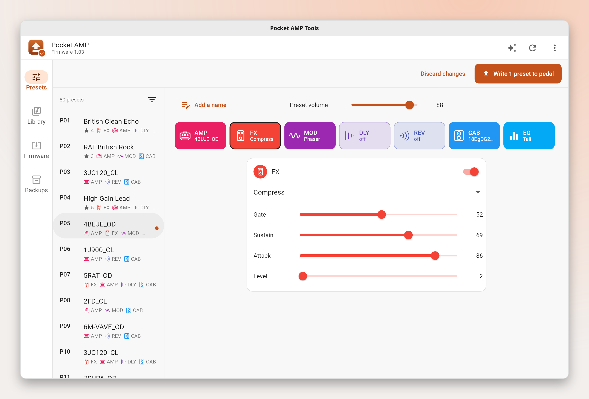

# Pocket AMP Tools

[](https://github.com/vitoramaral10/pocket-amp-tools/actions/workflows/build.yml)
[](https://github.com/vitoramaral10/pocket-amp-tools/releases)
[](https://github.com/vitoramaral10/pocket-amp-tools/releases)
[](LICENSE)


Update the firmware of the **M-VAVE Pocket AMP** guitar pedal (V1.05) over USB from **macOS, Linux or Windows**, with the official firmware file from M-VAVE. The goal is every Pocket AMP, whatever brand is printed on it: clones sold under other names, such as the Coolmusic PIXIE1, are supported too. Website: <https://vitoramaral10.github.io/pocket-amp-tools/>

M-VAVE's own updater runs only on Windows and, at the time of writing, its "POCKET AMP" bundle ships an older firmware than the one on the downloads page. This app sends the current `.fwsc` file from M-VAVE over plain USB-MIDI, so it needs no drivers.

<picture>
  <source srcset="docs/screenshot-dark.png" media="(prefers-color-scheme: dark)">
  
</picture>

> **Community tool, not affiliated with M-VAVE. Use at your own risk.** A firmware update that is interrupted can leave the pedal unusable.


> Formerly **Pocket AMP Upgrader**: it grew from a firmware updater into a preset editor, and was renamed.

## Download

Get the build for your system from the newest entry on the [releases page](../../releases) (the app is still in beta, so the releases are marked *pre-release*):

| System | File | How to run |
| --- | --- | --- |
| Windows 10/11 (x64) | `pocket-amp-tools-windows-x64.zip` | Unzip, run `pocket-amp-tools.exe`. If SmartScreen warns, choose *More info → Run anyway*. |
| macOS 11+ | `pocket-amp-tools-macos.zip` | Unzip, then right-click *Pocket AMP Tools* → *Open* (the app is not signed). |
| Linux (x64) | `Pocket_AMP_Tools-x86_64.AppImage` | `chmod +x` it and run it. Or use `pocket-amp-tools-linux-x64.tar.gz`. Needs GTK 3 and ALSA (`libasound2`). |

Each release lists the SHA-256 of every file in `SHA256SUMS.txt`. Releases after v0.2.0-beta.4 also let you check that a file was built by this repository's CI: `gh attestation verify <file> --repo vitoramaral10/pocket-amp-tools`.

## How to update

1. Know that a firmware update can overwrite some presets and their EQ. The app backs up all 80 presets and their EQ automatically before updating, and you can also save a backup to a file at any time.
2. Charge the pedal, connect it with a USB **data** cable and turn it on.
3. Close the M-VAVE app and anything else that uses MIDI (DAWs, browser tabs with Web MIDI).
4. Open Pocket AMP Tools. It detects the pedal and shows the installed version.
5. Click **Download from M-VAVE** (fetches the official file from M-VAVE's server) or **Open .fwsc file…** if you already have it.
6. Click **Update firmware**, confirm, and wait about two minutes. The pedal restarts twice: once into update mode, once into the new firmware.
7. Click **Restore my presets from before the update**. Only the presets and EQ that changed are written back, and the result is read back to check it.

To check the installed version on the pedal itself, hold **Home** and press **>**.

### Pocket AMP clones

The same pedal is sold under other brands, and each reports its own name. The app keeps a list of names confirmed to be a Pocket AMP. A listed clone is detected as *NAME (Pocket AMP)* and can get the Pocket AMP firmware after a separate confirmation. A pedal that is not on the list never gets a firmware update, because a different pedal that speaks the same protocol (an M-VAVE FM-1, for example) would be bricked by it. If its preset area reads like a Pocket AMP's, it is detected as *presets only*: backups, presets and raw copies work, updates do not.

| Clone | Reports | Status |
| --- | --- | --- |
| Coolmusic PIXIE1 | `PIXIE1_007` | updated to V1.05 by an owner ([#2](../../issues/2)) |
| New Bee SK17 | `SK17_006` | updated to V1.05 by an owner |
| Donner Pocket AMP | `DONNER Pocket AMP_008` | updated from V08 to V1.05 by an owner on Windows, presets kept ([discussion #1](../../discussions/1)) |

Have a clone that is not listed? Open the app, copy the log from **Details**, and send it with the [hardware test report](../../issues/new?template=hardware_report.yml) form.

Know before you cross-flash a clone:

- afterwards the pedal reports itself as a Pocket AMP, and there may be no firmware of the original brand to go back to;
- older clone firmware (PIXIE1 V0.07) keeps presets in the same layout but has no EQ table and cannot read past P79. The app keeps a raw copy (`raw-<pedal>-<date>.bin` in `Documents/Pocket AMP Tools`) and asks before continuing; after the update, **P01 to P79 can be restored** from it (the result card or **Backups**). P80 and the EQ stay as the new firmware has them. A raw copy in any other layout is not restored. Reading presets on that firmware shows P01 to P79 without the EQ, to view only: writing to it was never tested;
- after updating from V0.07, M-VAVE says to switch to Speaker mode and load the Speaker mode preset in M-EFCS to get sound.

### "Already runs this version"

The Pocket AMP does not reinstall the firmware it already has: it reads the package and stops. The app checks the version first and tells you instead of starting.

### If it stops halfway

Do not unplug the pedal in a hurry. If the app says the pedal did not come back, reconnect it, open the app again and click **Detect pedal**. A pedal waiting in update mode shows up as *update mode*, and **Resume update** writes the firmware again from there.

## Presets

The **Presets** section reads all 80 presets and their EQ from the pedal and lets you edit them: volume, the order of the signal chain, each block's on/off, model and knobs, and the EQ. AMP and CAB model names are read from the pedal, so models you uploaded show with their own names.

The chain keeps FX and AMP in its first two places (in either order); the other four blocks go in any order. A V1.05 pedal acknowledges and ignores any other order, so the editor does not offer it.

With **Live on pedal** (on by default), selecting a preset plays it on the pedal, and each change to a block, model, knob or the chain is heard as you make it. Live changes are not stored: switching presets on the pedal or turning it off brings back what is saved. Volume and EQ have no live command and are heard after writing. Changing a model resets that block's knobs to the new model's defaults, as on the pedal itself.

**Write to pedal** stores only the presets that changed, then reads everything back to confirm. If the pedal changed since its presets were read (a preset saved on the pedal, or another unit plugged in), nothing is written and the app asks for a new read. Every write is read back before it is stored, and is stored even when nothing differed, so a write whose storing step was lost is completed by the next one. Reading again, opening a file or closing the app with edits not on the pedal asks first. A preset can be copied as JSON and pasted back.

Each preset can also have a **name, description, genres, usage, tags and a 1 to 5 star rating**, set with the pencil button above the preset. The pedal has no room for these, so the app keeps them on your computer (`preset-details.json` in the app's data folder), one set per slot P01 to P80, whatever is stored in it; they are saved as you type and are not part of a backup file. The genres, usage and tags to pick from are yours to add and remove. The filter button above the list (beside the preset picker on a narrow window) shows only the presets that match: any of the values picked in a group, every group at once, and at least the chosen rating. The assistant sees these details too, and sets them when asked.

On the keyboard, **←**/**↑** and **→**/**↓** select the previous and next preset the filter shows (played on the pedal as a click would), **Page Up**/**Page Down** move 10 presets and **Home**/**End** go to the first and last; **F2** asks for a preset number and jumps to it whatever the filter shows. **1** to **7** open a block, counting from the left of the chain (EQ included); **Space** turns the open block on or off and **[**/**]** pick its previous or next model. **Ctrl+F** opens the filter and **Esc** clears it. **Ctrl+Shift+C** and **Ctrl+Shift+V** copy the preset as JSON and paste one into it. **Ctrl+S** writes to the pedal (after the usual confirmation), **Ctrl+Shift+S** saves to a file, **Ctrl+Z** discards every change (as the **Discard changes** button), and **Ctrl+O** and **Ctrl+R** open a file and read the pedal again (**⌘** for Ctrl on macOS). **?** (or **Keyboard shortcuts** in the ⋮ menu) lists them all.

**Ask the assistant** (the ✨ button on a preset) sends your request and the preset to an AI service you choose: any address that speaks the OpenAI chat-completions format, with your own model and key (kept on your computer in plain text, readable only by you on Linux and macOS). The answer goes into the editor, is checked like a backup file, and is heard live; nothing is stored until you write.

The **Cabinets** section lists the 20 CAB slots and puts your own IR in one: WAV, 44.1 kHz, mono, 24-bit, 2048 samples (the one format whose upload was measured). This writes to the pedal's flash and survives turning the pedal off. The IR that was in the slot is gone for good: firmware V1.05 has no way to read an IR back, and, from its code, it seems to keep only the first 1024 of the 2048 samples it is sent. So the app keeps its own copy of every IR it sends, in `Documents/Pocket AMP Tools/IRs` (one per slot, named `cab-NN--name.wav`), and the slot shows **Restore copy…** to send it again. IRs put there by the factory or another app have no copy.

The same section switches to the 20 **AMP** slots and puts an amp capture in one, in the two formats firmware V1.05 takes: an `.am3` capture with the `LMT` block M-EFCS adds when it sends one (6272 bytes; a bare 6204-byte `.am3` is refused, the app cannot compute that block yet), or a model in the pedal's own `NAM` format (7548 or 7836 bytes). That format is a fixed small network, not the `.nam` files shared on Tone3000 or by the NAM project: those must be converted first. Copies of the captures the app sends are kept in `Documents/Pocket AMP Tools/Amps`.

The **Backups** section lists the backups the app keeps in `Documents/Pocket AMP Tools` (one is taken automatically before each firmware update), and opens or restores any of them. Backups made when the app was called Pocket AMP Upgrader stay in `Documents/Pocket AMP Upgrader` and are listed too. On macOS the app runs in a sandbox, so that `Documents` folder is the app's own: `~/Library/Containers/io.github.vitoramaral10.pocketAmpUpgrader/Data/Documents`.

A backup file lists every preset as plain fields, and the app restores from those fields, so a file edited by hand or by another tool goes back to the pedal:

```json
{
  "preset": "P01",
  "volume": 60,
  "chain": ["FX", "AMP", "MOD", "DLY", "REV", "CAB"],
  "blocks": {
    "AMP": {
      "on": true,
      "model": "8DARKS_DS",
      "knobs": [
        { "label": "Gain", "value": 50 },
        { "label": "Level", "value": 60 },
        { "label": "Bass", "value": 45 },
        { "label": "Mid", "value": 55 },
        { "label": "Treble", "value": 50 },
        { "label": "knob6 (unused)", "value": 0 }
      ]
    }
  },
  "eq": { "on": true, "position": "tail", "bands": [2, 0, -1, 0, 3] }
}
```

Every preset lists all six blocks; the example shows one. Knobs go from 0 to 100 and EQ bands from -6 to 6. Each block lists its six stored knob values in order: the position decides which knob a value sets, and the `label` is only there to read, so it is not read back and a renamed label does not change what is restored. A label marked `(unused)` is a stored value the model does not use; it is kept so nothing is lost. A file the pedal cannot take is refused before anything is written, naming the preset and field. Model and knob names follow firmware V1.05 (list collected in [#11](../../issues/11)); the block order and model numbers are not yet confirmed on a pedal for every position. Backups saved by earlier versions (`presets@1`, and `presets@2` with knobs by name) still restore. A file records which model list named it (`"models"`); a file named with another list is refused rather than restored as different bytes.

### Bluetooth (Linux)

On Linux the app also finds the pedal over Bluetooth, through M-VAVE's own GATT service and BlueZ. Over Bluetooth you can read, edit (live too) and write presets; firmware updates and IR uploads need the USB cable, and the firmware version is not shown. This was checked on a pedal for reads and live edits; writing presets over Bluetooth is read back and checked like over USB.

The app never starts pairing, and only uses a pedal paired with this computer (a neighbour's pedal nearby is ignored). Pair it once in a terminal, then click **Detect again**:

```sh
bluetoothctl
> scan on          # wait for "Pocket AMP_BLE", note its address
> scan off
> pair  <address>
> trust <address>
> quit
```

> [!TIP]
> Pocket AMP has two Bluetooth interfaces: to edit presets you need to pair with `Pocket AMP_BLE` (the data connection), not `Pocket AMP` (BT audio interface).

## Safety checks

Before anything is written, the app:

- validates the whole `.fwsc` package (header, directory and CRC of every entry, chip `AC791N`);
- only accepts packages made for the Pocket AMP itself (a clone vendor's own package is refused, even for a clone), and only the update loader (`ota.bin`) whose SHA-256 is known (`ef1f2db8…`, the one in the official V1.05 package);
- knows the official package by its SHA-256 (V1.05: `9584e81d…`); any other package needs an extra confirmation, since only its update loader can be checked;
- updates only the exact pedal that was confirmed, and refuses to start while another pedal is plugged in;
- checks that the pedal on the USB port says it is a Pocket AMP (or a listed clone) before arming the transfer;
- only asks the pedal for its identity when it opens; presets are read only when you start an update or save a backup, and nothing is written until you confirm.
- checks every packet to the pedal against the exact shapes measured on a Pocket AMP before it is sent (reads of the preset area, live edits of the active preset, saving presets and EQ, the IR upload) and refuses anything else, so a bug cannot write somewhere new;
- closes the live editing connection before any other operation, and never edits live during a firmware update;
- sends nothing but preset traffic over Bluetooth: firmware updates and IR uploads are refused there.

## Status

| Platform | Detection | Full update |
| --- | --- | --- |
| Linux | tested with a real pedal; preset backup and restore too | the app's traffic was traced side by side with the Python prototype that updated a real pedal from V1.03 to V1.05: same requests, same answers. A full update by the app itself waits for the next firmware, because the pedal refuses to reinstall the version it already runs |
| Windows | works: a user's pedal was detected and its presets read ([#2](../../issues/2)) | works: a Coolmusic PIXIE1 was updated from V0.07 to Pocket AMP V1.05 ([#2](../../issues/2)), and a Donner Pocket AMP from V08 ([discussion #1](../../discussions/1)); in both, the first attempt stopped in update mode and the second finished |
| macOS | works: a New Bee SK17 was detected ([#6](../../pull/6)) | works: the same SK17 was updated to Pocket AMP V1.05, with a fork that differs only in which pedals it accepts ([#6](../../pull/6)) |

Reports are very welcome, including "it worked": use the [hardware test report](../../issues/new?template=hardware_report.yml) form.

## Help wanted

This is a community project and the next step depends on owners of the pedal:

- **Windows and macOS testers, especially with an M-VAVE Pocket AMP.** So far only clones have been updated on those systems. Open the app with your pedal connected and [tell us what you see](../../issues/new?template=hardware_report.yml). Detection alone is already useful.
- **Bug reports** with the log from **Details → Copy for a bug report** ([form](../../issues/new?template=bug_report.yml)).
- **Questions, tips and other pedals** go to [Discussions](../../discussions).
- **Code and docs**: see [CONTRIBUTING.md](CONTRIBUTING.md). Translations of this README are welcome.

If the app helped you, a ⭐ makes it easier for other Pocket AMP owners to find it.

## Troubleshooting

- **No pedal found.** Try another cable (many are charge-only) and another USB port. Make sure no other app has the MIDI port open. On Linux your user needs access to `/dev/snd/midi*` (usually the `audio` group or a desktop session).
- **"Could not open MIDI output" on Windows.** Another app owns the port; Windows lets only one app open a MIDI device at a time.
- **macOS says the app is damaged.** Run `xattr -dr com.apple.quarantine "Pocket AMP Tools.app"` once.

## How it works

The Pocket AMP runs on a JieLi AC791N, the same chip as the M-VAVE FM-1, and uses the same update loader. The protocol was learned from the browser updater that M-VAVE published in [FM1 Open](https://github.com/m-vave/fm1_open) (`sdk/WebUpdate.js`):

- frames are SysEx `F0 <7-bit packed [00 59 cmd len_lo len_hi 00 payload ~sum]> F7`;
- command `0x11` returns the identity (`Pocket AMP_105`, or `ota-Pocket AMP_103` in update mode);
- the raw message `F0 22 24 35 7F F7` arms a transfer, after which the pedal requests blocks with command `0x30` (`[seq, address u32, size u24]`) and the app answers with the bytes of the package;
- a request for address `0xE0000000` ends the loader phase and `0xF0000000` ends the flash phase; both are answered with `success\0`, and the pedal restarts.

The USB-MIDI transport is native on each system: ALSA rawmidi on Linux, WinMM on Windows (each SysEx send waits for the driver to finish with the buffer) and CoreMIDI on macOS (through [flutter_midi_command](https://pub.dev/packages/flutter_midi_command)).

## Error reports

Release builds ask once whether they may send error reports to Sentry. They are off until you agree, and the bug button at the top changes the answer. A report holds the error, the recent log lines, the app version, the system, and the pedal and firmware names; after each firmware update, one more says how it ended, so the pedals that update well are known. Presets, files and your user name are not sent, and your IP address is not stored. Builds without `--dart-define=SENTRY_DSN=...` have no reporting and never ask.

## Building

Requires Flutter 3.47 or newer.

```bash
flutter pub get
flutter test
flutter build linux     # or windows / macos, on that system
```

`flutter test test_hardware/` talks to a real pedal on Linux (identity query only). Set `POCKET_AMP_FWSC=/path/to/Pocket\ AMP.fwsc` to also run the tests against the official package.

## Contributing

See [CONTRIBUTING.md](CONTRIBUTING.md) and the [Code of Conduct](CODE_OF_CONDUCT.md). Safety problems (a way to write wrong data to a pedal) go through [private reporting](SECURITY.md).

## Thanks

Every clone on the list is there because an owner risked their own pedal and reported back.

- [ShinaTak1](https://github.com/ShinaTak1): first to update a Coolmusic PIXIE1 to V1.05 ([#2](../../issues/2)).
- [jtcornett](https://github.com/jtcornett): added the New Bee SK17 ([#6](../../pull/6)).
- [fernandoarafat](https://github.com/fernandoarafat): sent the detection log, photos and firmware of a Donner Pocket AMP, which made the Donner support possible (discussion [#1](../../discussions/1)).

Tested it on your pedal? Send the [hardware test report](../../issues/new?template=hardware_report.yml) and your name goes here.

## License

GPL-3.0-only. The update protocol follows M-VAVE's FM1 Open browser updater, which is GPL-3.0. M-VAVE, Pocket AMP and FM-1 are trademarks of their owners; the firmware belongs to M-VAVE and is not distributed with this app.
